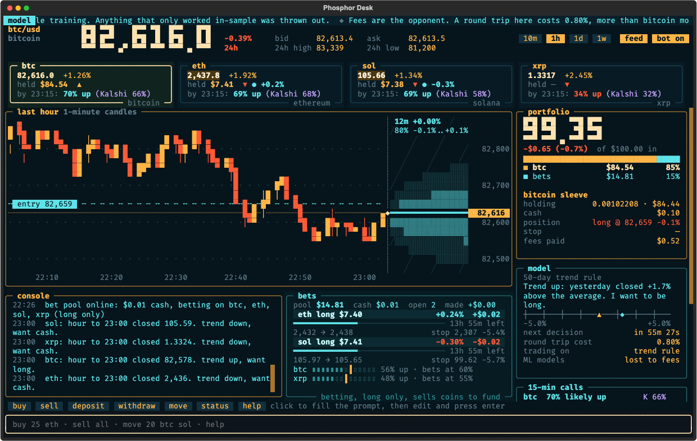
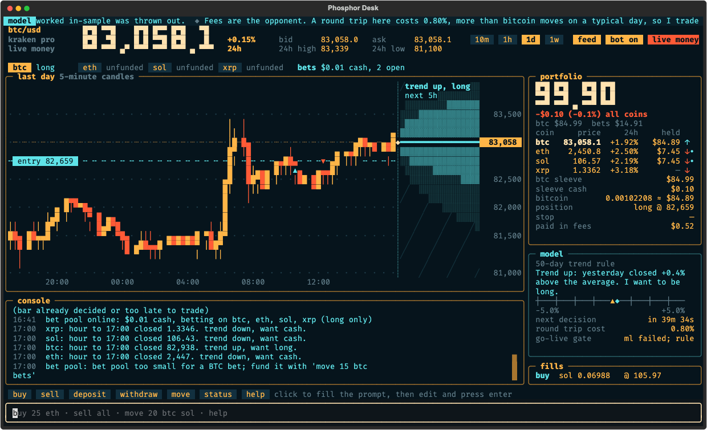
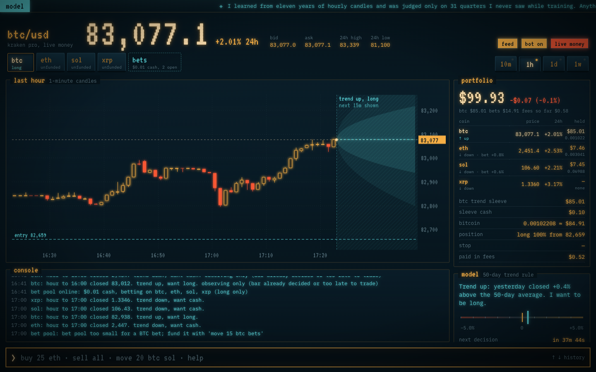
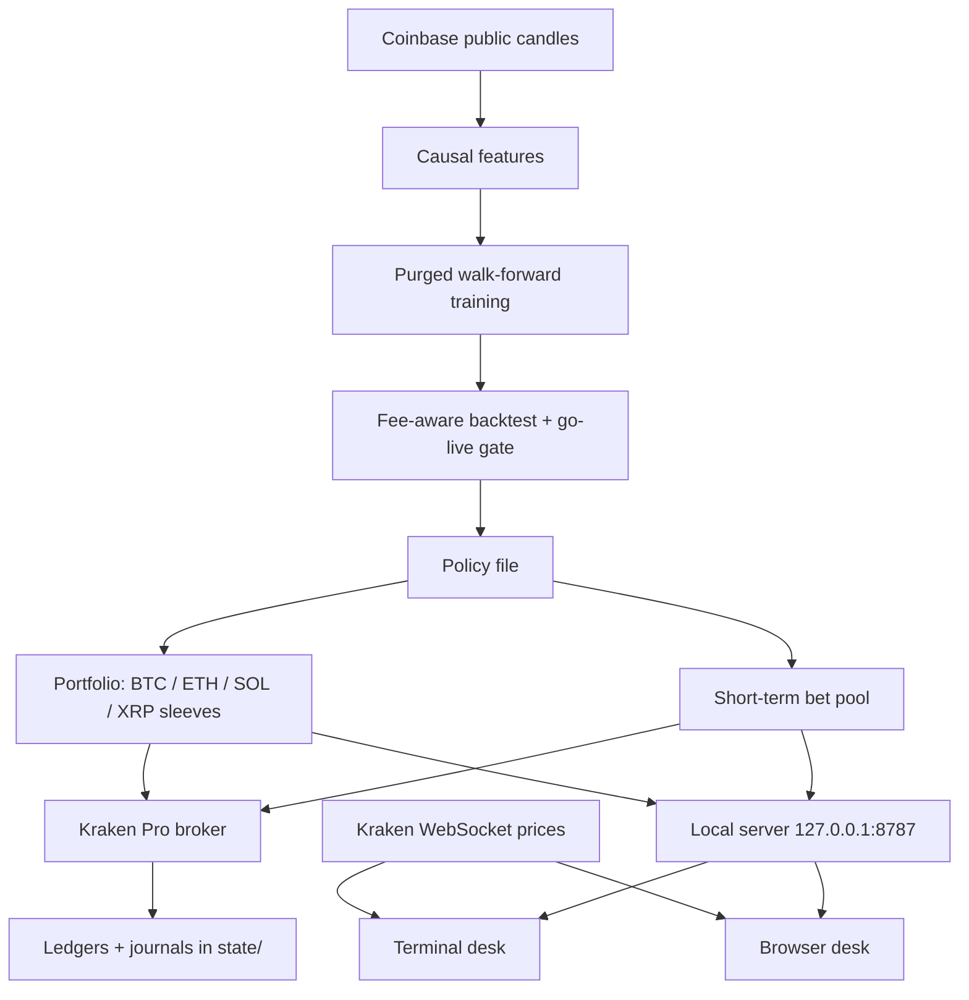

# CoinTrade


CoinTrade is a crypto price-prediction research pipeline and an automated trader for Bitcoin, Ethereum,
Solana and XRP on Kraken Pro (or Coinbase Advanced Trade), with a retro trading desk in the terminal and
in the browser. It tests state-of-the-art forecasting models honestly against exchange fees and only
trades a strategy that survives out-of-sample.

> **Risk notice.** This trades real money when you switch it to live mode. Every test in this project
> says short-term prediction does not beat exchange fees; the deployed rule is a simple trend filter
> that cut drawdowns in backtests but did not significantly beat holding. Nothing here is financial
> advice. Start in paper mode.

---

## Table of Contents

- [Features](#features)
- [Demo](#demo)
- [Project Story](#project-story)
- [Results & Impact](#results--impact)
- [Tech Stack](#tech-stack)
- [Architecture](#architecture)
- [Getting Started](#getting-started)
- [Usage](#usage)
- [Folder Structure](#folder-structure)
- [Author](#author)
- [Acknowledgments](#acknowledgments)

---

## Features

- Research pipeline: strictly causal hourly features, purged walk-forward training over 31 quarterly test folds (2019–2026), and a fee-aware backtest with a block bootstrap.
- Model shoot-out: LightGBM (regression and triple-barrier), Ridge, and zero-shot foundation models (Chronos-Bolt, Chronos-2), all judged by the same go-live gate.
- Live trading on Kraken Pro: post-only maker orders, HMAC-signed REST, crash-safe order recovery, and a ledger reconciled against the exchange.
- Multi-coin sleeves: BTC, ETH, SOL and XRP each run with their own cash, position and drawdown kill switch; move, convert and rebalance money between them.
- Short-term bet pool: per-coin calibrated up/down models place small bets only when confident enough, from a fenced pool of cash with stops.
- 15-minute up/down odds for each coin, settled like Kalshi's 15-minute markets (60-second average price before each quarter hour vs before its end), updated live with Kalshi's own price alongside; calibrated within ~3 points on six months of unseen 1-minute data (recommendations only; the bot never trades them).
- Forecast curves on every chart: a median path with 50% and 80% bands from 1 minute to 1 week, whose band coverage was checked on unseen data (the 80% band held 78–84% of outcomes up to a day).
- Phosphor Desk: a live chart (10m / 1h / 1d / 1w), all-coin market table, model notes and a command line, as a clickable terminal UI and as a browser UI.

---

## Demo

**Terminal desk** (`./tui.sh`): live price, the model's projection cone, the portfolio across all four coins, and clickable command chips.



**Terminal desk, one-day view**



**Browser desk** (http://127.0.0.1:8787)



---

## Project Story

The brief was to build a state-of-the-art Bitcoin price-prediction model and an app that buys and sells
at the best possible time, starting with $100 and free to trade as often as it likes. The research went
looking for the best available models (gradient-boosted trees, linear baselines, and foundation models
like Amazon's Chronos) and put every one of them through the same strict test: train only on the past,
pay real exchange fees, and beat simply holding.

None of the machine-learning models passed. They were right slightly more often than chance, but the
edge was far smaller than the 0.8% it costs to buy and sell. So the live bot trades the one rule that
held up, a 50-day trend filter, and keeps the ML research, the short-term bets and the evidence for
anyone who wants to try to beat it.

---

## Results & Impact

Out-of-sample, 31 quarterly test folds, 2019-01 to 2026-09, $100 start, Kraken fees (0.40% maker / 0.80% taker):

| Strategy | CAGR | Sharpe | Max drawdown | Trades/yr |
|---|---|---|---|---|
| Buy & hold | +49.5% | 0.96 | −77% | – |
| **SMA-50 trend filter** (long when daily close > 50-day average) | **+53.7%** | **1.20** | −61% | 9.7 |
| SMA-100 trend filter | +50.1% | 1.13 | −44% | 6.4 |
| Best ML: LightGBM / Ridge, 12h horizon | +2.0% | 0.23 | −16% | 7 |
| Validation-selected ML: LightGBM, 72h | −1.1% | −0.06 | −19% | 1 |

- **No ML configuration passed the go-live gate** at any fee level tested. Out-of-sample information coefficient was about 0.01–0.03.
- **Zero-shot foundation models** scored IC −0.03 (Chronos-Bolt) and −0.08 (Chronos-2) on 2025+ data.
- **Frequent short-term bets** (1h–24h, long and short): betting every hour turns $100 into $0; the best of 56 configurations picked in hindsight ends at $139, against $2,804 for the trend filter.
- **Confidence-gated bets** ("only bet when the probability is high enough"), three designs: $100 → $100.59, $60.68 and $92.26. The models' 70%+ calls came true only about 53% of the time.
- **15-minute calls** (`python -m btcbot.calls --train`, tested Jul–Oct 2026 on bars the models never saw): right 54–56% of the time when they make a call (10–19% of quarter hours), against ~50% for guessing, but they earn about nothing per call before fees (−0.1 to +0.9 bp) and lose ~79 bp after Kraken's 0.8% round trip. Shown as recommendations only.
- **The trend filter** beats buy & hold on Sharpe and drawdown, but not significantly (bootstrap p = 0.20), and only for 50–100 day windows. Treat it as risk reduction, not alpha.

Per coin, trend rule vs holding (`python -m btcbot.coin_eval`):

| Coin (test span) | Trend CAGR / max DD | Hold CAGR / max DD | Auto trading |
|---|---|---|---|
| BTC (2019–2026) | +55.3% / −58% | +48.9% / −77% | on |
| ETH (2019–2026) | +48.8% / −59% | +45.3% / −81% | on |
| SOL (2021–2026) | +44.2% / −73% | +8.8% / −97% | on |
| XRP (2023–2026) | +15.3% / −72% | +39.5% / −73% | off (manual only) |

---

## Tech Stack

**Modeling & Research**:
- LightGBM (Huber regression, calibrated classifiers, triple-barrier labels)
- scikit-learn (Ridge, isotonic calibration)
- Amazon Chronos-Bolt and Chronos-2 (zero-shot, via PyTorch)
- pandas, NumPy, PyArrow

**Trading Backend**:
- Python 3.12
- Kraken Pro REST + WebSocket v2 (HMAC-SHA512 signing)
- Coinbase Advanced Trade API (market data and optional broker)
- Local HTTP server (stdlib) with session token, Host/Origin checks and CSP

**Frontend**:
- Textual + Rich (terminal desk)
- HTML, CSS, JavaScript Canvas (browser desk)
- Exchange WebSocket price feeds

**Dev tools**:
- pytest (53 tests)
- uv
- Claude Code
- Git & GitHub

---

## Architecture

**Flow**:
- Hourly candles are downloaded and turned into features that only use past data.
- Models are trained and tested quarter by quarter on data they never saw, paying real fees.
- Only a policy that passes the go-live gate is exported; today that is the 50-day trend rule.
- Each hour, every coin's sleeve checks its trend and places post-only maker orders on Kraken.
- The bet pool places small, stopped bets when its calibrated model is confident enough.
- Both desks read the bot's local server and stream live prices; commands go back through the same server.

---

## Getting Started

1. Clone the repository
```bash
git clone https://github.com/cjr03/CoinTrade.git
cd CoinTrade
```
2. Install dependencies
```bash
uv venv --python 3.12 .venv
uv pip install --python .venv/bin/python -r requirements.txt
# optional, for the Chronos experiments: torch chronos-forecasting
```
3. Add environment variables in .env (live trading only; paper mode needs no keys):
```ini
KRAKEN_API_KEY=your_kraken_api_key_here
KRAKEN_API_SECRET=your_kraken_private_key_here
```
Give the key "Query funds" and "Query/Create/Cancel orders" permissions only, never withdrawal. See `.env.example` for the other settings.

4. Download data and build the models (market data and model files are not in the repository):
```bash
.venv/bin/python -m btcbot.data --products BTC-USD,ETH-USD,SOL-USD,XRP-USD --granularity ONE_HOUR --days 4200
.venv/bin/python -m btcbot.data --products BTC-USD --granularity FIVE_MINUTE --days 3580
.venv/bin/python -m btcbot.train                      # walk-forward out-of-sample predictions
.venv/bin/python -m btcbot.evaluate --fees kraken_0.40_0.80
.venv/bin/python -m btcbot.train --final --model lgbm --horizon 72
.venv/bin/python -m btcbot.bets --train                # short-term bet pool models
.venv/bin/python -m btcbot.data --products BTC-USD,ETH-USD,SOL-USD,XRP-USD --granularity FIFTEEN_MINUTE --days 730
.venv/bin/python -m btcbot.calls --train               # 15-minute call models
.venv/bin/python -m btcbot.data --products BTC-USD,ETH-USD,SOL-USD,XRP-USD --granularity ONE_MINUTE --days 180
.venv/bin/python -m btcbot.forecast --fit             # chart forecast bands
.venv/bin/python -m btcbot.coin_eval                   # per-coin trend vs hold
.venv/bin/python -m pytest -q tests
```
5. Run the bot (paper by default):
```bash
BTCBOT_EXCHANGE=kraken BTCBOT_POLICY=policy_momentum.json BTCBOT_COINS=BTC,ETH,SOL,XRP \
  .venv/bin/python -m btcbot.app
# live money on Kraken: ./run_live.sh  (sets BTCBOT_MODE=live BTCBOT_CONFIRM_LIVE=I_UNDERSTAND)
```
6. Browser desk is available at
```arduino
http://127.0.0.1:8787
```
7. Terminal desk
```bash
./tui.sh            # attaches to the running bot
./tui.sh --start    # or hosts a bot inside this terminal session
```

---

## Usage

- Start the bot, then open either desk; any number of desks can watch at once.
- Click a chart range (10m / 1h / 1d / 1w) or a coin card to switch views; with an empty prompt, ← / → step through btc, eth, sol and xrp (↑ / ↓ walk your command history).
- Click a command chip (buy, sell, deposit, withdraw, move) to fill the prompt, finish the amount, and press enter. In live mode, money commands ask for a `confirm CODE` first.
- Type `help` for every command:

| Command | What it does |
|---|---|
| `buy 25 eth`, `buy all sol` | market buy with that coin's sleeve cash |
| `sell 25`, `sell 50%`, `sell all`, `sell 0.0002 btc` | market sell |
| `deposit 50 eth` | paper: add cash; live: hand $50 of exchange USD to that sleeve |
| `withdraw 20` | paper: remove cash; live: send to your bank (off unless `BTCBOT_ALLOW_WITHDRAW=1`) |
| `move 20 btc eth`, `move 15 btc bets` | move cash between sleeves or into the bet pool |
| `convert 20 btc eth`, `convert all sol xrp` | sell one coin and buy another |
| `rebalance btc 50 eth 30 sol 20` | redistribute everything to those percentages |
| `bets`, `bets on/off` | bet pool status and control |
| `bot off/on`, `resume`, `status`, `view 1d`, `coin sol`, `clear` | control and display |

**Safety rails**: post-only maker orders priced at the decision price, never chasing it · market orders only for stops and the kill switch · $110 per-order cap · fee guard · stale-data guard · open orders cancelled on startup · 35% drawdown kill switch that halts until a human resumes · the bot only trades its own ledger, never the rest of the account · the server binds to 127.0.0.1 and every command needs the session token.

---

## Folder Structure

```plaintext
CoinTrade/
├─ btcbot/
│  ├─ data.py          # Coinbase public candle downloader (parquet cache)
│  ├─ features.py      # strictly causal hourly features
│  ├─ train.py         # purged walk-forward training, --final
│  ├─ backtest.py      # fee-aware simulator, metrics, block bootstrap
│  ├─ evaluate.py      # threshold selection, baselines, go-live gate, policy export
│  ├─ chronos_eval.py  # zero-shot Chronos-Bolt / Chronos-2 challenger
│  ├─ coin_eval.py     # per-coin trend vs hold evidence
│  ├─ coins.py         # coin identifiers per venue
│  ├─ broker.py        # Coinbase broker + paper broker
│  ├─ kraken.py        # Kraken Pro live + paper broker
│  ├─ trader.py        # per-coin sleeves and the portfolio
│  ├─ bets.py          # short-term bet pool
│  ├─ app.py           # local server and command line
│  ├─ tui.py           # terminal desk (Textual)
│  └─ web/             # browser desk (index.html, app.js, style.css)
├─ artifacts/          # policy files and evaluation reports
├─ docs/               # screenshots
├─ tests/
├─ run_live.sh
├─ tui.sh
├─ requirements.txt
├─ .env.example
├─ README.md
└─ LICENSE
```

---

## Author

**Cole Roberts**

*M.S. Artificial Intelligence, Santa Clara University*

Email: cole03roberts@gmail.com

LinkedIn: https://www.linkedin.com/in/cole03roberts/

---

## Acknowledgments

Kraken Pro and Coinbase Advanced Trade APIs for market data and execution.
Amazon Chronos, LightGBM, scikit-learn, and Textual.
Built with Claude Code.
